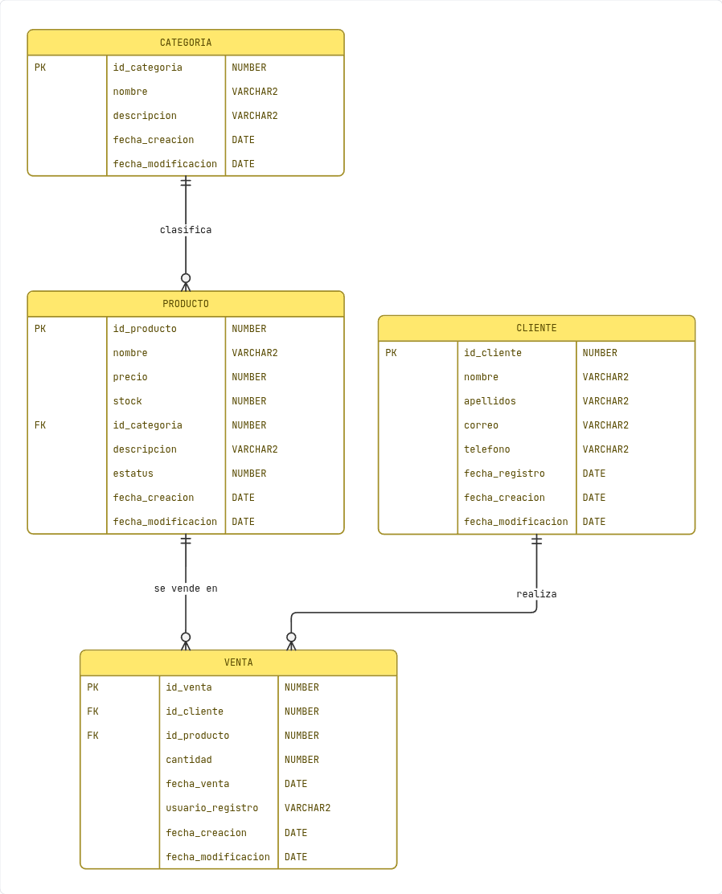

# Gestión de Inventario y Registro de Ventas

Modelo de datos en **Oracle SQL** para administrar categorías, productos, clientes y ventas. Incluye tablas normalizadas y documentadas, vistas, un procedimiento almacenado para registrar ventas y dos funciones, junto con sus pruebas y evidencias.


---

## Contenido del repositorio

```
unube-inventario-ventas/
├── README.md
├── scripts/
│   ├── 01_creacion_tablas.sql
│   ├── 02_inserciones.sql
│   ├── 03_vistas.sql
│   ├── 04_funciones_sp.sql
│   └── 05_pruebas.sql
├── docs/
│   └── DER.png
└── evidencias/
    └── (capturas de las pruebas)
```

## Requisitos

- Oracle Database **12c o superior** (las llaves primarias usan columnas `IDENTITY`).
- Un cliente SQL que ejecute scripts de Oracle (SQL Developer, DataGrip, DBeaver, SQL*Plus, etc.).
- Un usuario con permisos para crear tablas, vistas, funciones y procedimientos.

## Cómo ejecutarlo

Ejecutar los scripts **en orden**, todos con el mismo usuario:

| Orden | Script | Qué hace |
|---|---|---|
| 1 | `scripts/01_creacion_tablas.sql` | Elimina (si existen) y crea las 4 tablas con claves, campos de auditoría y comentarios. |
| 2 | `scripts/02_inserciones.sql` | Inserta datos de ejemplo directamente en las tablas. |
| 3 | `scripts/03_vistas.sql` | Crea las 2 vistas. |
| 4 | `scripts/04_funciones_sp.sql` | Crea las 2 funciones y el procedimiento almacenado. |
| 5 | `scripts/05_pruebas.sql` | Ejecuta las pruebas unitarias. |

> Los scripts `04` y `05` contienen bloques PL/SQL terminados con `/`. Hay que ejecutarlos como script completo, no sentencia por sentencia.
>
> Las pruebas usan IDs fijos (cliente 2, producto 2, etc.), por lo que deben correrse sobre una base recién creada con el script `01`.

## Modelo de datos



| Relación | Cardinalidad |
|---|---|
| CATEGORIA - PRODUCTO | Una categoría tiene muchos productos (1:N). Cada producto pertenece a una sola categoría. |
| CLIENTE - VENTA | Un cliente puede tener muchas ventas (1:N). Cada venta pertenece a un solo cliente. |
| PRODUCTO - VENTA | Un producto puede aparecer en muchas ventas (1:N). Cada venta registra un solo producto. |

### Tablas

- **CATEGORIA**: clasifica los productos del inventario.
- **PRODUCTO**: catálogo con precio, stock y estatus (1 activo, 0 inactivo).
- **CLIENTE**: datos de contacto de los clientes.
- **VENTA**: transacciones realizadas, con el usuario que las registró.

Todas incluyen los campos de auditoría `FECHA_CREACION` y `FECHA_MODIFICACION`, y cada tabla y columna está documentada con `COMMENT ON TABLE` y `COMMENT ON COLUMN`. Las llaves primarias se generan automáticamente.

### Vistas

- `vw_producto_categoria`: productos junto con el nombre de su categoría.
- `vw_venta_detalle`: ventas con los datos del cliente y del producto, y el total de cada venta.

### Funciones

- `fn_total_venta(p_id_venta)`: devuelve el total de una venta (cantidad × precio).
- `fn_calcular_iva(p_monto, p_tasa)`: devuelve el IVA de un monto. La tasa por defecto es 0.16.

### Procedimiento almacenado

`sp_registrar_venta(p_id_cliente, p_id_producto, p_cantidad, p_usuario, p_id_venta OUT)`

Registra una venta validando lo siguiente. El ID de la venta se genera automáticamente y el stock se descuenta al registrarla.

| Código | Validación |
|---|---|
| -20001 | La cantidad debe ser mayor que cero. |
| -20002 | El cliente debe existir. |
| -20003 | El producto debe existir. |
| -20004 | El producto debe estar activo. |
| -20005 | Debe haber stock suficiente. |

## Pruebas

El script `05_pruebas.sql` cubre:

1. Consulta de las 4 tablas con los datos insertados.
2. Consulta de las 2 vistas.
3. Venta correcta con el procedimiento (se descuenta el stock).
4. Venta rechazada por stock insuficiente (`ORA-20005`).
5. Venta rechazada por cliente inexistente (`ORA-20002`).
6. Venta rechazada por producto inexistente (`ORA-20003`).
7. Verificación de que las ventas rechazadas no se registraron.
8. Ejecución de `fn_total_venta` y `fn_calcular_iva`.

> Los mensajes de las pruebas 4 a 6 se muestran con `DBMS_OUTPUT`, por lo que hay que tener abierta la salida de DBMS_OUTPUT en el cliente SQL.
